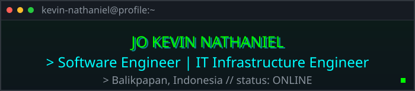
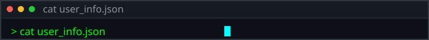
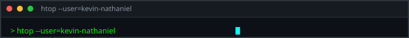
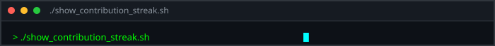
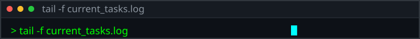
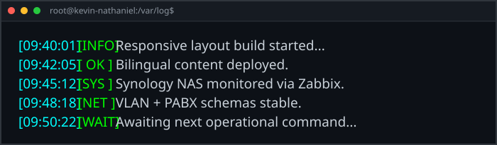
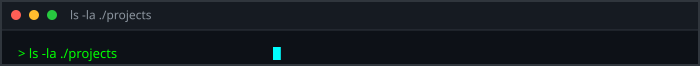
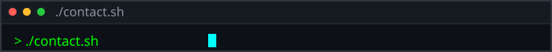
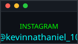
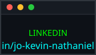

<p align="center">
  
</p>

<p align="center">
  +Initializing+system...;>+Welcome+to+Jo+Kevin+Nathaniel's+Terminal;>+System+status:+ONLINE" alt="Typing SVG" />
</p>



```json
{
  "name": "Jo Kevin Nathaniel",
  "base_location": "Balikpapan, Indonesia",
  "education": "Kalimantan Institute of Technology",
  "current_operations": [
    "Network Infrastructure",
    "Server Management",
    "Responsive Web Development"
  ],
  "modules_loaded": [
    "Gaming",
    "Audio Engineering",
    "Photography"
  ]
}
```



<p align="center">
  
  
</p>



<p align="center">
  
</p>







- **modul-pembelajaran** — learning modules, Go · [Ouroboros-Technology-ITK](https://github.com/Ouroboros-Technology-ITK/modul-pembelajaran)
- **spotify-clone** — Spotify clone, TypeScript · [kevin-nathaniel/spotify-clone](https://github.com/kevin-nathaniel/spotify-clone)
- **TKids-new** — TKids app, Dart · [kevin-nathaniel/TKids-new](https://github.com/kevin-nathaniel/TKids-new)
- **my-portofolio** — bilingual portfolio site, Vue 3 + TypeScript + Tailwind CSS · [kevin-nathaniel/my-portofolio](https://github.com/kevin-nathaniel/my-portofolio)

```text
./modules_loaded [Gaming, Audio Engineering, Photography]
```



<p align="center">
  <a href="https://www.instagram.com/kevinnathaniel_10/"></a> <a href="https://www.linkedin.com/in/jo-kevin-nathaniel/"></a>
</p>
